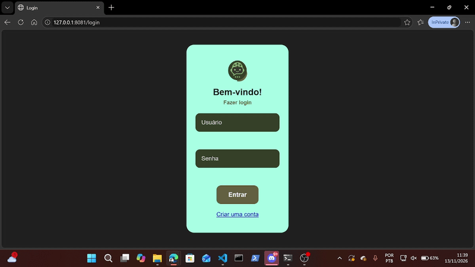
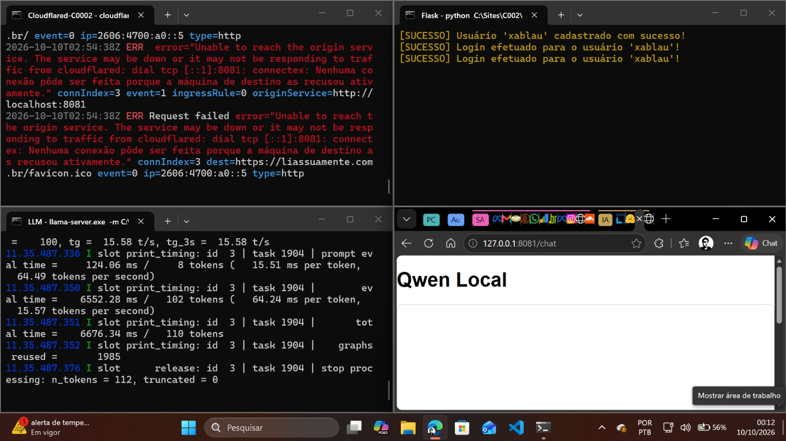
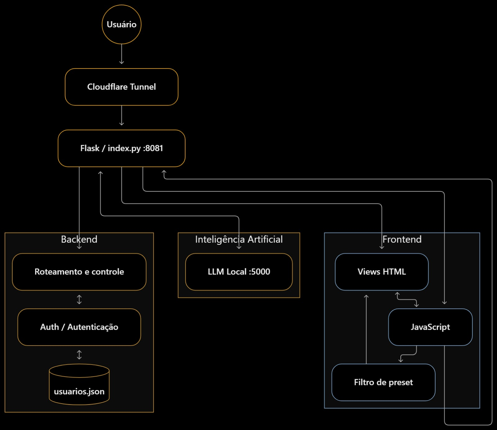

# L.I.A. — Local Intelligent Assistant

<p align="center">
  
</p>

<p align="center">
  <strong>Projeto acadêmico de desenvolvimento de uma aplicação web de inteligência artificial.</strong>
</p>

<p align="center">
  🌐 <strong>Acesse a aplicação:</strong>
  <a href="https://liassuamente.com.br" target="_blank">
    liassuamente.com.br
  </a>
</p>

<p align="center">
  Desenvolvido no contexto universitário e disponibilizado no repositório institucional da faculdade.
</p>

<p align="center">
  
  
  
  
</p>

---

## Demonstração

<p align="center">
  
</p>
---

## Sobre o projeto

A L.I.A. (Local Intelligent Assistant) é um projeto de inteligência artificial desenvolvido como aplicação web, utilizando Python e Flask para gerenciamento das requisições, autenticação de usuários e comunicação com um modelo de linguagem executado localmente.

O projeto busca explorar uma arquitetura modular, com separação de responsabilidades entre interface, backend, autenticação e processamento das mensagens, mantendo o controle da infraestrutura e da execução do modelo.

## Interface

<p align="center">
  
</p>

## Arquitetura e infraestrutura

A aplicação utiliza uma estrutura de comunicação entre o usuário, a camada de acesso web, o servidor Flask e o serviço responsável pela execução do modelo de linguagem.

<p align="center">
  
</p>

### Fluxo de funcionamento

1. O usuário acessa a aplicação através do domínio.
2. O Cloudflare Tunnel encaminha a requisição para o servidor.
3. O Flask recebe a solicitação através do ponto de entrada `index.py`.
4. O sistema identifica a rota e direciona o usuário para o recurso correspondente.
5. O backend processa as solicitações e realiza a comunicação com a API local do modelo.
6. A resposta é retornada à interface de chat.

## Funcionalidades

- Cadastro e autenticação de usuários.
- Gerenciamento de sessões.
- Interface de conversação com IA.
- Comunicação entre o backend Flask e a API local do modelo.
- Organização modular do código.
- Controle de requisições simultâneas ao modelo.

## Tecnologias utilizadas

- Python
- Flask
- HTML5
- CSS3
- JavaScript
- bcrypt
- API compatível com OpenAI Chat Completions
- Modelo de linguagem local

## Requisitos

- Python compatível com as dependências do projeto.
- Modelo de linguagem local configurado e em execução.
- Dependências listadas em `requirements.txt`.

## Instalação

1. Clone este repositório:

   ```bash
   git clone URL_DO_REPOSITORIO
   ```

2. Acesse o diretório:

   ```bash
   cd LIA
   ```

3. Crie e ative um ambiente virtual Python:

   ```bash
   python -m venv venv
   ```

4. Instale as dependências:

   ```bash
   python -m pip install -r requirements.txt
   ```

5. Configure as variáveis de ambiente necessárias.

6. Inicie o serviço local do modelo de linguagem.

7. Execute a aplicação Flask conforme a configuração do projeto.

## Segurança

Dados de usuários, credenciais, chaves privadas, arquivos de configuração locais e pesos dos modelos não devem ser versionados neste repositório.

As configurações sensíveis devem ser mantidas fora do código-fonte e gerenciadas através de variáveis de ambiente.

## Status do projeto

**Primeira versão funcional.**

O projeto continuará recebendo melhorias relacionadas à arquitetura, segurança, desempenho, manutenção e expansão de funcionalidades.

## Licença

Este projeto está licenciado sob os termos da licença MIT. Consulte o arquivo `LICENSE` para obter mais informações.
